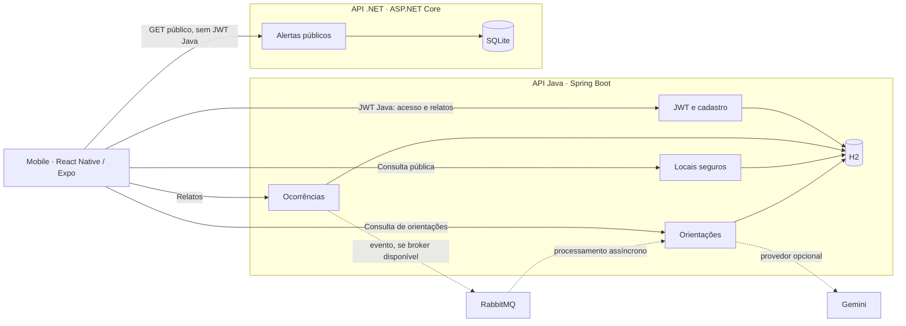

<div align="center">

# Refúgio 360

**Informação comunitária para apoiar decisões em situações de risco.**

Aplicativo da **Global Solution 2026/2 · FIAP**, desenvolvido com React Native, Expo e TypeScript.


</div>

Em enchentes e alagamentos, informações importantes podem estar dispersas. O Refúgio 360 reúne relatos enviados pelos cidadãos, locais de apoio cadastrados, orientações associadas às ocorrências e alertas públicos em uma interface acessível a quem precisa consultar essas informações. **É um protótipo acadêmico, não um serviço oficial de emergência.**

## Neste README

- [Funcionalidades](#funcionalidades)
- [Arquitetura e serviços](#arquitetura-e-serviços)
- [Estrutura do projeto](#estrutura-do-projeto)
- [Instalação e desenvolvimento](#instalação-e-desenvolvimento)
- [Qualidade e testes](#qualidade-e-testes)
- [APK Android com EAS Build](#apk-android-com-eas-build)
- [Demonstração em vídeo](#-demonstração-em-vídeo)
- [Equipe e responsabilidade](#equipe-e-responsabilidade)

## Funcionalidades

- **Acesso:** cadastro de cidadãos, login JWT pela API Java, restauração da sessão validada pela API e logout local. O token fica no Expo SecureStore; a senha não é armazenada no aplicativo.
- **Locais seguros:** lista paginada, detalhe com endereço e coordenadas, atualização manual e abertura em aplicativo de mapas.
- **Ocorrências:** registro de relatos com urgência e coordenadas; lista paginada **Minhas ocorrências** e detalhe dos relatos do usuário.
- **Orientações:** consulta paginada no detalhe da ocorrência, com espera limitada e distinção entre resultado gerado por IA e fallback local.
- **Alertas públicos:** lista e detalhe dos alertas publicados pela API .NET, incluindo identificação visual de conteúdo DEMO.
- **Navegação:** Início, Minhas ocorrências, Locais seguros, Alertas, Perfil e Sobre; Login, Cadastro e Sobre também estão disponíveis antes do acesso.

O aplicativo **não** implementa edição/exclusão de ocorrências nem gera orientações por conta própria. Para orientações automáticas, a API Java precisa conseguir publicar e consumir eventos no RabbitMQ. Gemini é opcional no backend; sem broker, uma orientação pode não aparecer, mesmo havendo fallback local para quando a geração for acionada. A disponibilidade dessa cadeia **não está confirmada** no serviço hospedado.

## Arquitetura e serviços



O Mobile mantém clientes HTTP separados em `src/api/clients.ts`: `javaClient` acessa recursos Java, enquanto `dotnetPublicClient` consulta somente alertas públicos e **não recebe o JWT Java**. As coleções Java são páginas Spring (campo `content`); os alertas .NET vêm em um array JSON.

| Serviço de demonstração no Render                     | Responsabilidade                                          | Consultas públicas usadas pelo app                 |
| ----------------------------------------------------- | --------------------------------------------------------- | -------------------------------------------------- |
| [API Java](https://java-refugio360-b723.onrender.com) | Cadastro/login, ocorrências, locais seguros e orientações | `/api/locais-seguros` e `/api/locais-seguros/{id}` |
| [API .NET](https://dotnet-refugio-360.onrender.com)   | Alertas publicados                                        | `/api/v1/alertas` e `/api/v1/alertas/{id}`         |

Os seis locais `DEMO -` e o alerta `DEMO -` são **fictícios**: não comprovam capacidade, disponibilidade ou situação em tempo real. Instâncias gratuitas do Render podem demorar a responder após inatividade; as telas exibem estado de carregamento, erro e nova tentativa manual. Os clientes usam timeout de **10 s** (Java) e **8 s** (.NET), sem retry automático de criação de ocorrência. O H2 e o SQLite em filesystem efêmero **não garantem persistência** entre reinícios ou deploys.

## Estrutura do projeto

```text
src/
├── api/          # clientes HTTP e serviços para os endpoints reais
├── components/   # botões, campos, cabeçalho e estados reutilizáveis
├── config/       # leitura das URLs de ambiente
├── features/     # auth, home, occurrences, locations, alerts, profile e about
├── navigation/   # fluxos público/autenticado, pilha e abas
├── session/      # contexto, ciclo de vida e armazenamento seguro do JWT
├── theme/        # cores, tipografia e espaçamentos
├── types/        # tipos dos contratos das APIs
└── utils/        # formatação e tratamento de erros
```

## Instalação e desenvolvimento

**Pré-requisitos:** Node.js 20+ e npm 10+ (projeto validado com Node 24.14.0 e npm 11.9.0), acesso às duas APIs e Expo Go compatível com SDK 58 em um aparelho Android ou emulador. Não é necessário instalar Expo CLI globalmente.

```bash
git clone https://github.com/Last-Global-Solution/mobile-refugio360.git
cd mobile-refugio360
npm install
cp .env.example .env
npm start
```

Abra o QR code mostrado pelo Expo no **Expo Go**. Com um emulador Android configurado, `npm run android` também inicia o fluxo de desenvolvimento. O script `npm run ios` requer um ambiente iOS compatível. O aplicativo já foi validado em **dispositivo físico via Expo Go**.

### URLs de ambiente

O arquivo `.env.example` contém as URLs HTTPS públicas usadas na entrega:

```dotenv
EXPO_PUBLIC_JAVA_API_URL=https://java-refugio360-b723.onrender.com
EXPO_PUBLIC_DOTNET_API_URL=https://dotnet-refugio-360.onrender.com
```

São **URLs-base**, sem `/api` ou `/api/v1`: os serviços do aplicativo acrescentam os caminhos necessários. `src/config/environment.ts` remove barras finais excedentes. O `.env` local é ignorado pelo Git, não deve conter segredos, tokens ou credenciais, e serve ao Expo Go; as mesmas URLs públicas estão configuradas diretamente no perfil `preview` de `eas.json` para o build remoto. Após mudar variáveis locais, reinicie o Metro (`npm start`; se necessário, `npx expo start --clear`).

## Qualidade e testes

```bash
npm run typecheck       # TypeScript
npm run lint            # ESLint
npm run format:check    # Prettier
npm test                # Jest
npx expo-doctor         # diagnóstico Expo
npx expo install --check # compatibilidade das dependências com o SDK
```

Os testes automatizados usam Jest e Axios Mock Adapter; não dependem das APIs hospedadas. Na última validação registrada da configuração Mobile, **94 testes Jest**, TypeScript, ESLint e Prettier passaram, e o Expo Doctor concluiu **20/20 verificações**. Isso não equivale a testar o APK instalado.

## APK Android com EAS Build

**Expo Go** executa o aplicativo durante o desenvolvimento. O perfil **`preview`** do `eas.json` prepara um **APK de distribuição interna**, instalável sem Expo Go nem Metro, com `distribution: internal`, `android.buildType: apk`, ambiente EAS `preview` e assinatura Android gerenciada remotamente pelo EAS. O package Android é `br.com.fiap.refugio360`; a versão em `app.json` é `0.1.0`.

O projeto está vinculado a `@murilomacedosilva/refugio-360`. Antes de solicitar um build, mantenha o Git limpo: `cli.requireCommit=true`. `app.config.js` injeta em `extra.buildCommit` o SHA completo do checkout Git, que a tela **Sobre** apresenta junto da versão; no Expo Go ela não atribui ao desenvolvimento o commit de um APK. Compare esse SHA com o commit indicado na página do build EAS.

```bash
eas project:info --non-interactive
eas build --platform android --profile preview
```

Na primeira compilação, o EAS pode solicitar a criação/seleção da keystore remota. Acompanhe o status no painel do projeto ou com `eas build:list --platform android`. **No momento desta revisão, o build do perfil `preview` está na fila; ainda não há APK ou link de artefato concluído.** Após finalizar, obtenha o `.apk` na página do build, baixe-o no Android, autorize a instalação por essa origem quando o sistema solicitar e confirme as telas e o SHA na versão instalada.

## 🎬 Demonstração em vídeo

**[Vídeo de demonstração — adicionar link após publicação]**

O vídeo técnico do Mobile ainda não possui URL informada. O vídeo Pitch de outra parte da solução não é apresentado como demonstração deste aplicativo.

## Equipe e responsabilidade

- **Instituição:** FIAP
- **Entrega:** Global Solution 2026/2
- **Curso:** _preencher curso_
- **Grupo:** _preencher nome/número do grupo_

Integrantes e RMs registrados na documentação da API Java do mesmo projeto:

| Integrante                    | RM     |
| ----------------------------- | ------ |
| Gabriely Bonfim Silva         | 566242 |
| Henrique Rodrigues Vespasiano | 562917 |
| Mirelly Sousa Alves           | 566299 |
| Ruan Luca Feliciano           | 562218 |
| Murilo Macedo Silva           | 566462 |

> **Responsabilidade:** protótipo acadêmico com dados DEMO fictícios. Não substitui Defesa Civil, bombeiros, serviços médicos nem outros canais oficiais de emergência. Confirme informações de locais e alertas em fontes oficiais antes de agir.
